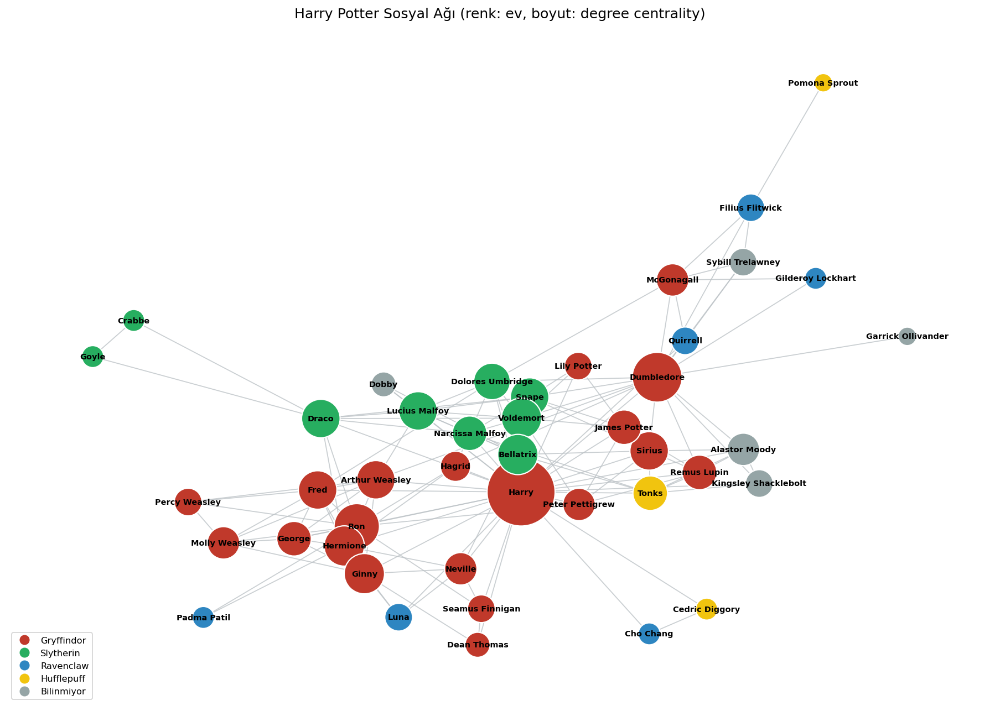
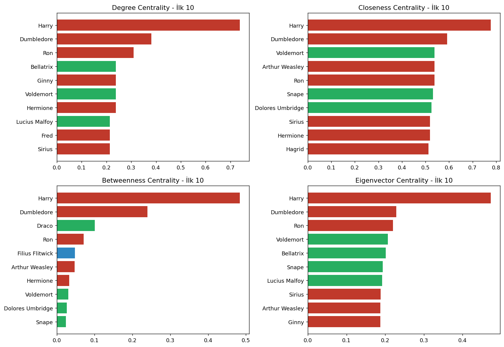
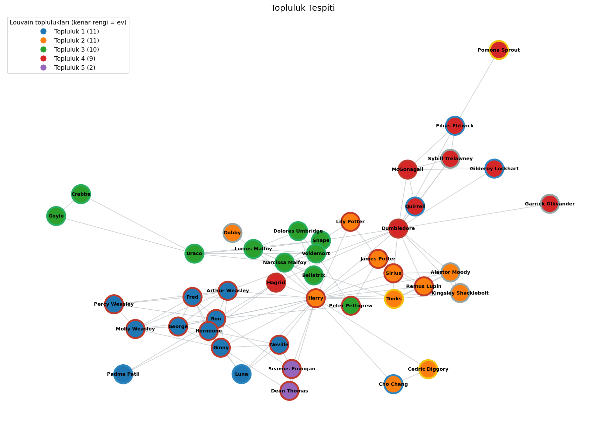
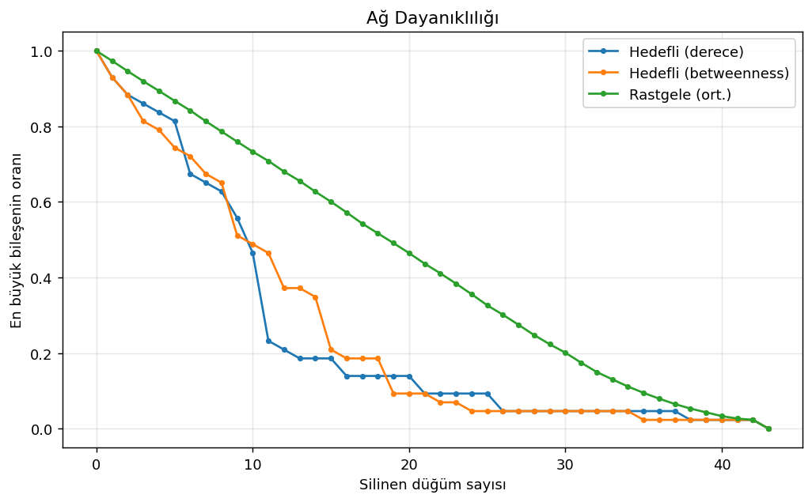
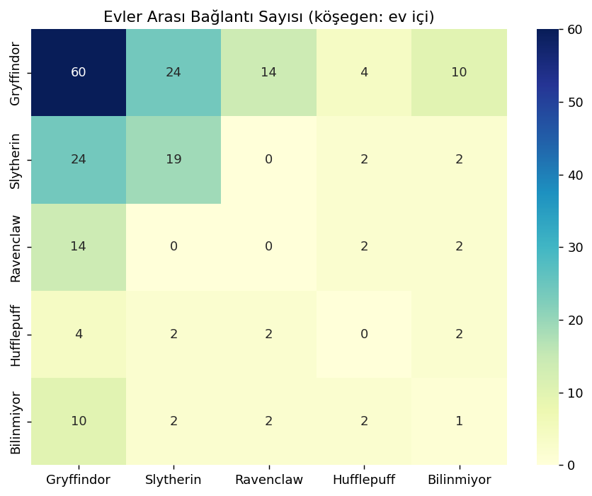
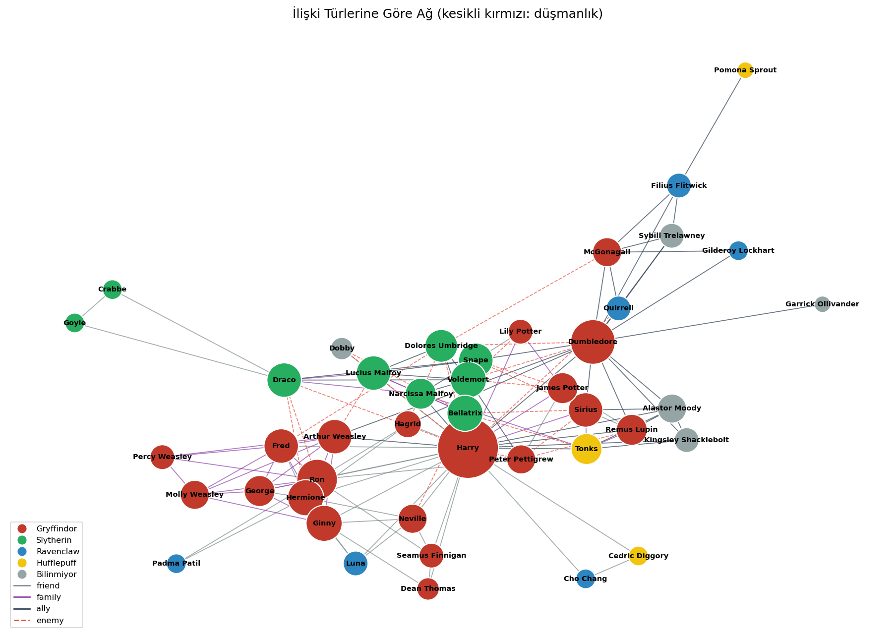

# Harry Potter Sosyal Ağ Analizi (Graf Teorisi)

  

Harry Potter dünyasındaki karakterleri **graf teorisi** ile modelleyen ve **sosyal ağ analizi** yöntemleriyle inceleyen bir Ayrık Matematik projesi. Karakterler düğüm, aralarındaki arkadaşlık, aile, müttefiklik ve düşmanlık ilişkileri kenar olarak temsil edilir. Proje; merkezilik, topluluk tespiti, dayanıklılık, small-world ve yapısal denge analizlerini tekrarlanabilir bir Python paketi olarak sunar.



> Düğüm rengi Hogwarts evini, boyutu *degree centrality* değerini gösterir.

## Araştırma Soruları ve Bulgular

| Soru | Bulgu |
|---|---|
| Ağın merkezinde kim var? | Harry tüm merkezilik ölçülerinde birinci (degree 31, betweenness 0.484); Dumbledore ikinci. |
| Evler sosyal olarak kümeleniyor mu? | Evet, ama zayıf: assortativity r = 0.405 (permütasyon testi p < 0.001). Louvain toplulukları evlerden daha iyi bir bölümleme veriyor (modularity 0.490 > 0.227). |
| Ağ ne kadar dayanıklı? | Hedefli saldırıda yalnızca 5 düğüm silinince en büyük bileşen %81'e düşüyor; rastgele silmede %87. Kesim noktaları: Harry, Dumbledore, Draco, Flitwick. |
| Small-world mu? | Evet: σ = 3.94 (kümelenme 0.632, rastgele ağda 0.158; ortalama yol 2.19, rastgele 2.15). |
| Dostluk/düşmanlık tutarlı mı? | Üçgenlerin %90.7'si Heider anlamında dengeli (156 / 172). Dengesizler Snape, Pettigrew ve Narcissa gibi çelişkili karakterlerde toplanıyor. |

> **Önemli not:** Veri Harry'nin bakış açısıyla derlendiği için Harry'nin yüksek skorları kısmen örneklem yanlılığıdır (ego-network etkisi). Ayrıntılar için "Sınırlılıklar" bölümüne bakın.

## Ağ Özeti

| Özellik | Değer |
|---|---|
| Düğüm (karakter) sayısı | 43 |
| Kenar (ilişki) sayısı | 142 (40 friend, 31 family, 44 ally, 27 enemy) |
| Graf türü | Yönsüz, ağırlıklı (1-3), ilişki türü etiketli |
| Yoğunluk | 0.157 |
| Ortalama kümelenme katsayısı | 0.632 |
| Geçişlilik (transitivity) | 0.386 |
| Bağlı bileşen sayısı | 1 |
| Çap / yarıçap | 5 / 3 |
| Ortalama en kısa yol | 2.185 |

## Yapılan Analizler

- **Merkezilik:** degree, closeness, betweenness, eigenvector, PageRank, k-core. Metriklerin birbirleriyle Spearman korelasyonu.
- **Yapısal kırılganlık:** kesim noktaları (articulation points) ve köprü kenarlar.
- **Dayanıklılık:** hedefli (derece / betweenness) ve rastgele düğüm silme simülasyonu.
- **Evler:** evler arası bağlantı matrisi, assortativity katsayısı ve permütasyon testi.
- **Topluluk tespiti:** Louvain; modularity ve NMI ile evlerle karşılaştırma.
- **Small-world analizi:** Erdős–Rényi rastgele graflarla kıyaslama (σ).
- **Yapısal denge (Heider):** dost/düşman işaretli üçgenlerin dengeli/dengesiz sayımı.
- **Derece dağılımı:** histogram ve log-log tamamlayıcı birikimli dağılım.

### Merkezilik



| Metrik | İlk 5 |
|---|---|
| Degree | Harry (31), Dumbledore (16), Ron (13), Hermione (10), Ginny (10) |
| Closeness | Harry (0.778), Dumbledore (0.592), Ron / Voldemort / Arthur Weasley (0.538) |
| Betweenness | Harry (0.484), Dumbledore (0.239), Draco (0.100), Ron (0.071), Flitwick (0.048) |
| Eigenvector | Harry (0.473), Dumbledore (0.228), Ron (0.220), Voldemort (0.207), Bellatrix (0.202) |
| PageRank | Harry (0.102), Dumbledore (0.061), Ron (0.045), Ginny (0.035), Draco (0.035) |

Draco'nun yüksek betweenness değeri, Crabbe–Goyle ikilisini ağa bağlayan tek karakter olmasından gelir.

### Topluluklar



Louvain, evlerden çok **hikâye rollerini** yakalar: Weasley / Dumbledore Ordusu çevresi, Order ve Potter ailesi, Ölüm Yiyenler, Hogwarts kadrosu. Topluluk tespiti ve assortativity yalnızca dostça ilişkilerle (friend, family, ally) yapılır; çünkü düşmanlık kenarları iki karakteri aynı topluluğa ait kılmamalıdır.

### Dayanıklılık



### Evler Arası Bağlantılar



Gryffindor ev içi (60) ve Slytherin ile (24) yoğun bağlantılıdır. Slytherin–Ravenclaw arasında hiç kenar yoktur.

### İlişki Türleri



## Proje Yapısı

```
HarryPotterGraph/
├── data/
│   ├── characters.csv          # karakter, ev
│   └── relationships.csv       # kaynak, hedef, ilişki türü, ağırlık
├── src/hpgraph/
│   ├── data.py                 # yükleme, doğrulama, graf oluşturma
│   ├── metrics.py              # tüm analiz fonksiyonları
│   └── plots.py                # görselleştirme
├── scripts/run_analysis.py     # tüm analizleri çalıştırır, grafik + sonuç üretir
├── notebooks/HarryPotter.ipynb # anlatımlı analiz (çıktılarıyla)
├── notebooks/archive/          # projenin ilk sürümü (v1)
├── tests/                      # pytest birim testleri
├── results/                    # summary.json, centrality_metrics.csv
├── docs/images/                # README görselleri
├── docs/Ayrik_Matematik_Rapor.pdf   # ders raporu
├── docs/Proje_Mulakat_Rehberi.pdf   # proje ve kod rehberi (mülakat hazırlığı)
└── .github/workflows/ci.yml    # CI: test + analiz
```

## Kurulum ve Çalıştırma

```bash
git clone https://github.com/MelihAliCagman/HarryPotterGraph.git
cd HarryPotterGraph

python -m venv .venv && source .venv/bin/activate   # Windows: .venv\Scripts\activate
pip install -e ".[dev]"

python scripts/run_analysis.py     # grafikleri ve results/ çıktılarını üretir
pytest                             # testleri çalıştırır
jupyter notebook notebooks/HarryPotter.ipynb
```

## Veri Modeli

`data/relationships.csv` sütunları:

| Sütun | Açıklama |
|---|---|
| `source`, `target` | Karakter adları (`characters.csv` ile eşleşmeli) |
| `relation` | `friend`, `family`, `ally`, `enemy` |
| `weight` | 1-3: ilişki yoğunluğu (**öznel** puan) |

Veri yüklenirken doğrulanır: yinelenen karakter, bilinmeyen düğüm, kendine bağlanan kenar, geçersiz ilişki türü/ağırlık/ev adı ve yinelenen ilişki çifti hata verir. Yeni karakter veya ilişki eklemek için yalnızca CSV dosyalarını düzenlemek ve `python scripts/run_analysis.py` çalıştırmak yeterlidir.

## v1'den v2'ye Değişiklikler

- "Lupin" ve "Remus Lupin" aynı karakter olduğu halde iki ayrı düğümdü; **birleştirildi**.
- Gilderoy Lockhart'ın evi Gryffindor yerine **Ravenclaw** olarak düzeltildi. Evi kesin bilinmeyen karakterler (Trelawney, Ollivander, Moody, Kingsley, Dobby) "Bilinmiyor" olarak işaretlendi.
- Yinelenen kenar (`Harry–Luna`) temizlendi; eksik bariz ilişkiler (Ron–Ginny, Ron–Hagrid, Harry–Neville vb.) eklendi. Bunlar yüzünden Cho Chang ve Cedric ana ağdan kopuk görünüyordu; artık ağ **tek bileşen**.
- Yalnızca "arkadaşlık" modellenmişti; **ilişki türleri ve düşmanlık** eklendi.
- Karakter sayısı 32'den 43'e, kenar sayısı 57'den 142'ye çıkarıldı.
- Notebook'ta tekrar eden hücreler ve gömülü veri kaldırıldı; kod yeniden kullanılabilir pakete, veri CSV'ye taşındı.
- Birim testleri, veri doğrulaması, CI ve sonuçların otomatik üretimi eklendi.
- README'deki sayılar artık `results/summary.json` dosyasından gelen gerçek çıktılardır.

## Sınırlılıklar

- Veri filmlerden/kitaplardan **elle** derlenmiş öznel bir listedir; resmî bir veri seti değildir. Sonuçlar seçilen karakter ve ilişkilere bağlıdır.
- Veri Harry merkezli toplandığı için Harry'nin skorları örneklem yanlılığı içerir. Harry çıkarılınca ağın nasıl davrandığı dayanıklılık grafiğinde görülebilir.
- Kenar ağırlıkları öznel puanlardır; sahne sayısı gibi ölçülmüş bir değer değildir. Yol tabanlı metrikler (closeness, betweenness) bu yüzden ağırlıksız hesaplanır.
- 43 düğümlü bir ağda istatistiksel testler (assortativity, σ) yol göstericidir, kesin kanıt değildir.

## Kullanılan Teknolojiler

Python 3.10+, NetworkX, pandas, NumPy, SciPy, Matplotlib, Seaborn, pytest, Jupyter, GitHub Actions.

## Ekip

Üç kişilik ekiple Gazi Üniversitesi Bilgisayar Mühendisliği Ayrık Matematik dersi kapsamında geliştirilmiştir. Ders raporu: [Ayrik_Matematik_Rapor.pdf](docs/Ayrik_Matematik_Rapor.pdf). Proje ve kod rehberi: [Proje_Mulakat_Rehberi.pdf](docs/Proje_Mulakat_Rehberi.pdf).

## Lisans

[MIT](LICENSE)
